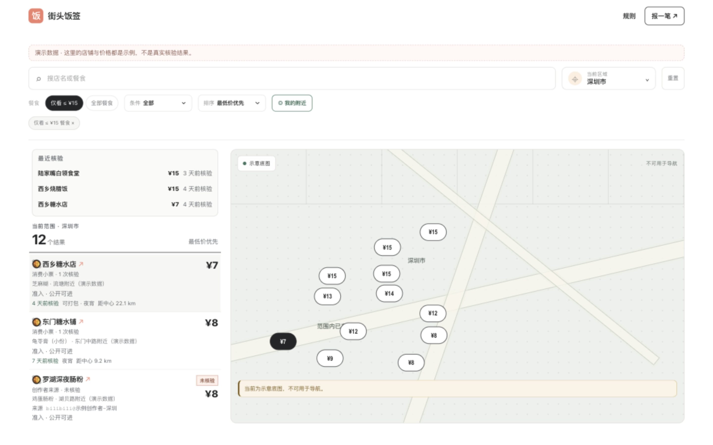
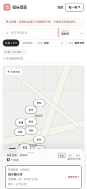

# 街头饭签 · Street Food Map

[](https://github.com/IamDuXiu/street-food-map/actions/workflows/ci.yml)
[](LICENSE)
[](package.json)

一张**平价餐食地图**：记录的不是「这家店不错」，而是「这家店的**这份饭**、**哪天核验过**、**多少钱**」。

给想在 30 秒内找到一顿便宜、能吃饱、价格有据可查的饭的人用。数据是按「具体餐食 + 具体价格 + 具体核验日期」存的，不是人均消费估算，也不收录一次性优惠价。

> 这是一个**可以直接自己部署运行**的开源项目：一条命令拉起服务，自带演示数据。**不需要任何第三方账号或付费 Key 也能跑起来**（地图默认是内置的纸上地图）；只有想用腾讯真实底图或自动采集时，才需要填入**你自己账号**申请的 Key。

<p align="center">
  
</p>

<p align="center">
  
</p>

> 截图取自仓库自带的演示数据（深圳）。

---

## 它解决什么

外卖平台按销量和评分排序，把 15 元的盖饭和 45 元的套餐混在一起；团购券价格随时变动，很难判断「现在这家店到底有没有一份 15 元以内、能吃饱的饭」。

街头饭签只回答一种问题：**哪些店、现在、有一份不超过 15 元的单人餐食**。

- **店级门槛**：店里至少有一份 ≤ ¥15 的单人餐食即可收录；其余餐食如实标价（sanity 上限 ¥200）。
- **180 天新鲜度**：价格核验超过 180 天会从地图隐去，直到有人重新确认，不会一直挂着过期价格。
- **可信度分级**：高可信（现场菜单 / 价签 / 小票）、中高可信（商户官方菜单或两名独立用户确认）、需留意日期；社区内容只作为线索，永远标注「未核验」。
- **来源可追溯**：每条价格都记录来源与核验日期；创作者内容只保存元数据与外链，不搬运视频或封面。
- **公开范围白名单**：当前公开北京、上海、广州、深圳、杭州 5 城；其余城市的数据入库但不公开，避免用低质量数据铺满全国。

---

## 部署前须知道：第三方凭据要你自己准备

本项目的第三方服务凭据（腾讯地图 Key、大模型 Key）**必须由你本人申请**。仓库与镜像里不包含任何 Key，也没有供大家共用的公共 Key——可以自己验证：

```bash
git grep -nIE "TENCENT_MAP.*KEY\s*=\s*\S|MINIMAX_API_KEY\s*=\s*\S"   # 无输出即为干净
```

**借用别人的 Key 通常也走不通**：腾讯位置服务的 Key 可以在控制台绑定**你自己的域名白名单**（浏览器端）或 **IP 白名单**（服务端）；大模型 Key 的调用量计入申请者账号的账单与配额，共享会同时带来费用与封号风险。

### 什么功能需要什么凭据

| 功能 | 需要的凭据 | 不配置的后果 |
|---|---|---|
| 前台地图（**默认**） | 无 | 使用内置「纸上地图」，不需要网络与账号 |
| 前台腾讯真实底图 | `NEXT_PUBLIC_MAP_MODE=tencent` + `NEXT_PUBLIC_TENCENT_MAP_KEY`（你自己申请，绑定你的域名白名单） | 安全回退为内置纸上地图（`preflight` 会报配置错误） |
| 后台登录与审核 | `ADMIN_PASSWORD` 或 `ADMIN_PASSWORD_HASH` | 前台照常工作，但 `/admin` 无法登录、投稿无法审核 |
| 后台地址 → 坐标自动地理编码 | `TENCENT_MAP_WEB_SERVICE_KEY`（选填，可绑 IP 白名单） | 改为人工填写 / 点选坐标，功能不受影响 |
| `npm run collect:web` 网页采集 | `MINIMAX_API_KEY`（按你的账号计费） | 该采集脚本不可用，站点运行不受影响 |
| `npm run collect:creators` B站采集 | `BILIBILI_COOKIE`（选填） | 仍可匿名抓取，只是更容易遇到限流 |

### 怎么配置

只有一个配置文件：**项目根目录的 `.env`**（从 `.env.example` 复制）。Next.js、`docker compose` 与 `scripts/` 下的脚本（含 `preflight` 与采集脚本）都会读它；已导出的进程环境变量优先级最高。

```bash
cp .env.example .env
# 取消注释并填写；至少要设置 ADMIN_PASSWORD
npm run preflight          # 部署前自查：缺什么、缺了会怎样，都在这里说清楚
```

照 `.env.example` 里的注释逐项填写即可：**要不要用真实底图、要不要跑采集**决定了你还需不需要额外申请 Key。填错了不用猜——`npm run preflight` 会直接把后果和修法列出来；容器启动时也会在日志开头打印同一份清单（`docker compose logs app`）。

---

## 快速开始

两种方式，选一种即可。所有配置都是可选的（**不配也能跑**，只是地图用内置的纸上地图）；生产环境记得设置管理员密码，正式上线前先跑一次 `npm run preflight`。

### 方式 A：Docker Compose（推荐，最省事）

> 忘了准备凭据也没关系：容器日志开头会打印一份凭据清单，`npm run preflight` 也能随时自查。

```bash
git clone https://github.com/IamDuXiu/street-food-map.git
cd street-food-map
cp .env.example .env
# 编辑 .env：至少要取消注释并设置 ADMIN_PASSWORD（管理员密码，≥12 字符）
docker compose up -d
```

打开 <http://localhost:3000>。首次启动会自动建库、跑迁移、写入区域目录与演示数据，并按 `ADMIN_PASSWORD` 创建管理员（后台入口 `/admin/login`，默认用户名 `admin`）。`SESSION_SECRET` 不填也行——容器首次启动会生成一个随机值并持久化到数据卷里。

数据库与上传文件放在 Docker 命名卷 `street-food-map-data` 里，容器重建不会丢数据。

### 方式 B：本机 Node.js

需要 **Node.js 22+**（Next.js 16 要求 ≥20.9，但 Node 20 已停止维护，本项目按 22 LTS 开发与测试，见 `.nvmrc`）。

```bash
git clone https://github.com/IamDuXiu/street-food-map.git
cd street-food-map
npm install
export ADMIN_PASSWORD='your-local-password'   # 至少 12 个字符
npm run setup                                 # 建库 + 迁移 + 演示数据 + 写会话密钥
npm run dev
```

打开 <http://localhost:3000>。

生产模式：

```bash
npm run build
npm run start
```

### 想看演示数据长什么样

`npm run setup` / 容器首次启动默认写入 `SEED_DEMO=1` 的演示数据（深大粤海、科技园附近的几家店）。想从空库开始，设 `SEED_DEMO=0`，区域目录仍会写入，地图上显示真实的空状态「待共建」，不会用假数据伪装覆盖。

---

## 配置

所有配置都写在**项目根目录的 `.env`**（从 [`.env.example`](.env.example) 复制），完整说明见 [docs/CONFIGURATION.md](docs/CONFIGURATION.md)；`npm run preflight` 会逐项报告你当前的配置状态。最小可用集合：

| 变量 | 用途 | 默认 |
|---|---|---|
| `ADMIN_PASSWORD` | 首次启动时初始化后台管理员密码（≥12 字符） | 空（不建账号） |
| `ADMIN_PASSWORD_HASH` | 已有密码哈希时优先使用（`npm run admin:password` 生成） | 空 |
| `ADMIN_USERNAME` | 后台用户名 | `admin` |
| `SESSION_SECRET` | 后台会话签名 / 匿名来源指纹盐，**≥32 字符** | 容器内自动生成并持久化；本机由 `npm run setup` 写入 `.env.local` |
| `NEXT_PUBLIC_MAP_MODE` | `demo` 或 `tencent` | `demo` |
| `NEXT_PUBLIC_TENCENT_MAP_KEY` | 腾讯地图 JS API GL 浏览器端 Key | 空（用纸上地图） |
| `TENCENT_MAP_WEB_SERVICE_KEY` | 腾讯地址 → GCJ-02 坐标（服务端，选填） | 空（降级为手工填坐标） |
| `DATA_DIR` | SQLite、上传、备份的根目录 | 本地 `data/`；容器 `/data` |

**注意事项**

- `NEXT_PUBLIC_*` 会被 Next.js 在**构建期**内联，Docker 部署时必须在 build 阶段提供（`docker-compose.yml` 已接好 `build.args`），运行时再改无效。
- `SEED_DEMO=0` 用于生产：只写区域目录、不写演示门店。
- 第三方凭据（腾讯地图 / 大模型）必须是你自己账号申请的值，**仓库不内置任何 Key**；凭据只写进 `.env`（已被 `.gitignore` 忽略），**不要提交**。

---

## 数据从哪里来

街头饭签不靠自动抓取铺量，靠「**发现 → 人工核验 → 结构化入库**」：

1. **人工核验**：现场菜单、价签、小票，或商户官方菜单 / 两名独立用户确认。
2. **用户匿名投稿**（`/submit`）：新地点、价格变化、纠错、停业四类；只发一次查询码用于查状态；图片在服务端重新编码为 WebP 并去除 EXIF；公开前需要人工隐私复核。
3. **创作者内容聚合**（次要来源）：B站 / YouTube 的公开元数据，只作线索，展示时标「未核验 · 创作者来源」并链接回原内容。
4. **搜索引擎采集**（可选，需自备 LLM Key）：`npm run collect:web` 用搜索引擎广撒网 + LLM 抽取店名/地址/菜品/价格，产出待人工确认的 JSON。
5. **CSV 两阶段导入**：预览 → 人工确认坐标 → 全有或全无提交。

采集脚本只做**发现**，不会把猜测写入公开数据；抽取不到就写「待补」占位并标记。合规与平台边界见 [docs/DATA-SOURCES.md](docs/DATA-SOURCES.md)（不抓取小红书/抖音/大众点评，只存创作者元数据与外链）。

---

## 技术栈

- **Next.js 16**（App Router）+ **React 19** + **TypeScript 5.6**（strict）
- **SQLite**（better-sqlite3，WAL）+ 版本化 SQL 迁移；模块化单体，页面/API 不直接写 SQL，一律经 repository/service
- **Zod** 校验、**Sharp** 图片重编码、**Vitest** 单测、**Playwright** 端到端
- 地图：**腾讯 JS API GL**，无 Key 时降级为内置 Demo 地图（不需要网络和密钥）

```
app/           页面与 API 路由（App Router）
components/    用户端与后台组件
lib/           领域模型、城市白名单、动效等
lib/server/    仓储、鉴权、迁移、采集导入、审计
db/migrations/ 版本化 SQL 迁移（当前 schema 11）
scripts/       setup / 采集 / 备份恢复 / 运维脚本
e2e/           Playwright 端到端用例
docs/          架构、部署、配置、数据来源、后台手册
docs/archive/  历史过程记录（不代表当前状态）
```

---

## 常用命令

```bash
npm run dev            # 本地开发
npm run build          # 生产构建
npm run start          # 生产启动
npm run setup          # 建库 + 全量迁移 + 区域目录 + 演示数据
npm run preflight      # 部署前凭据自查（缺必需项会以退出码 1 结束）
npm run admin:password # 生成 ADMIN_PASSWORD_HASH（不落 shell 历史）
npm run backup         # 生成一致性备份 ZIP（含 manifest + SHA-256）
npm run restore -- --from backups/<file>.zip --confirm RESTORE-BUDGET-MAP
npm run collect:creators   # B站 / YouTube 元数据采集 → 待导入 JSON
npm run collect:web        # 搜索引擎 + LLM 抽取 → 待导入 JSON
npm run lint && npm run typecheck && npm test && npm run build
npm run test:e2e       # Playwright（隔离临时库，不碰你的 data/）
```

---

## 部署

自托管（Docker Compose、裸机 systemd、反向代理 + HTTPS）、备份恢复、上线安全检查清单，见 [docs/DEPLOYMENT.md](docs/DEPLOYMENT.md)。

架构与数据模型见 [docs/ARCHITECTURE.md](docs/ARCHITECTURE.md)；后台日常操作见 [docs/ADMIN-GUIDE.md](docs/ADMIN-GUIDE.md)。

---

## 贡献

欢迎提交 issue 和 PR：修 bug、补城市目录、改进无障碍与移动端体验、补充文档都很有用。开始前请读 [CONTRIBUTING.md](CONTRIBUTING.md)。安全问题请按 [SECURITY.md](SECURITY.md) 私下报告，不要开公开 issue。

## 许可证

[MIT](LICENSE)。

## 免责声明

本项目是一个数据目录工具，不提供餐饮服务，也不对收录店铺的价格、营业状态、食品安全作任何担保；价格以店铺现场为准。采集与展示请遵守目标站点的服务条款、`robots.txt` 与当地法律；请勿将本项目用于抓取个人隐私信息或绕过平台风控。地图底图与地理编码由腾讯地图提供，使用时需遵守其服务条款。
